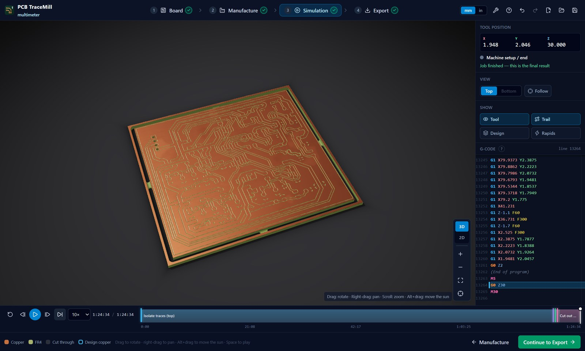

# PCB TraceMill: free PCB milling software (Gerber to G-code for hobby CNC)

**Mill your own printed circuit boards at home.** PCB TraceMill turns the Gerber and Excellon drill files from **KiCad, EasyEDA, Altium, Eagle or Fusion Electronics** into ready-to-run G-code for **Mach3 / Mach4, GRBL and LinuxCNC**. It covers isolation milling, drilling, cutout with tabs and double-sided boards, with a realistic 3D simulation and auto-levelling. It is free and open source (MIT) for Windows, macOS and Linux.

**Website:** https://aazriel.github.io/pcbtracemill/ · **Guide:** [How to mill a PCB on a hobby CNC router](https://aazriel.github.io/pcbtracemill/guide.html)



## Download

| System | File |
|---|---|
| **Windows** 10/11 | [`PCB-TraceMill-Setup.exe`](https://github.com/aazriel/pcbtracemill/releases/latest) |
| **macOS** (Apple Silicon & Intel) | [`PCB-TraceMill-universal.dmg`](https://github.com/aazriel/pcbtracemill/releases/latest) |
| **Linux** (any distribution) | [`PCB-TraceMill-x86_64.AppImage`](https://github.com/aazriel/pcbtracemill/releases/latest) |
| **Linux** (Ubuntu / Debian) | [`PCB-TraceMill-amd64.deb`](https://github.com/aazriel/pcbtracemill/releases/latest) |

All files are on the [latest release](https://github.com/aazriel/pcbtracemill/releases/latest) page. The installers are not code-signed yet. On Windows click **More info → Run anyway**. On macOS right-click the app and choose **Open**.

## Features

- **Import:** Gerber RS-274X (X1/X2), Excellon PTH/NPTH, ZIP archives and folders. Layer type and side are detected automatically from KiCad, Altium, Eagle and EasyEDA file names.
- **One-click Recipe:** a complete job with suitable bits, depths and feeds, using your own tools first.
- **Isolation milling with smart clearance:** depth and number of passes come from the measured copper gaps. Narrow gaps get one groove down the middle.
- **Copper clearing, drilling and hole milling:** drills are grouped by size, and holes bigger than your drills are milled in a spiral.
- **Cutout with tabs:** always outside the board outline.
- **Double-sided boards** with alignment pins.
- **Realistic 3D simulation** of the material removal, with tool-accurate walls and G-code sync.
- **Auto-levelling:** generates a probe program and bends the G-code to follow the measured copper surface.
  - On Mach3 the heights stay in Mach3 variables, with no macros and no file to load.
  - GRBL and LinuxCNC probe logs can be loaded.
  - Each bit finds Z0 on copper that is still connected to the probe clip, shown on a board map.
- **Machine presets:** Mach3 routers, GRBL 3018, Genmitsu, Shapeoko, LongMill, LinuxCNC and desktop PCB mills.
- **Output:** one file per step, per tool or combined, as `.tap`, `.nc` or `.ngc`.

PCB TraceMill is an easy-to-use alternative to FlatCAM, CopperCAM and pcb2gcode. Every setting is explained in plain words.

## Feedback and support

- Problems and ideas: [open an issue](https://github.com/aazriel/pcbtracemill/issues/new/choose). Questions and photos of your boards: [Discussions](https://github.com/aazriel/pcbtracemill/discussions). Reviews: [on the website](https://aazriel.github.io/pcbtracemill/#reviews).
- PCB TraceMill is free and stays free. If you would like to say thanks: [support it on Ko-fi](https://ko-fi.com/aazriel) ☕

## Development

```bash
npm install
npm run dev          # Electron app with hot reload
npm test             # unit + golden tests (Vitest)
npm run lint && npm run typecheck
npm run test:e2e     # Playwright Electron end-to-end (use xvfb-run on headless Linux)
npm run dist         # installers for the current OS (electron-builder)
```

Architecture: all CAM logic lives in `src/core` (pure TypeScript, no DOM/Electron/React; runs in Node and Web Workers). The renderer (`src/renderer`) talks to `src/workers` through comlink. See `docs/DECISIONS.md`, `docs/USER_GUIDE.md`, `docs/POSTPROCESSORS.md`.

`scripts/make-demo-board.mjs` generates the demo KiCad board in `fixtures/boards/demo-kicad`; `scripts/smoke.mjs` renders any stage in headless Chromium for screenshots.

License: MIT.
